  

  7+ years taking machine learning to production: forecasting and optimization models first,
  now self-hosted LLM platforms on Kubernetes&nbsp;— GPU inference, retrieval, evaluation and GitOps&nbsp;delivery.

Based in Turkey

## What I work on

<table>
  <tbody>
  <tr>
    <td width="2000">
      <b>LLM platforms</b> 
      Deploy and operate LLM applications on Kubernetes with GPU inference on vLLM. Build RAG with
      dense retrieval on Qdrant, and Graph RAG with Cypher traversal over Neo4j knowledge&nbsp;graphs.
    </td>
  </tr>
  </tbody>
  <tbody>
  <tr>
    <td>
      <b>Evaluation and observability</b> 
      Run curated test sets with LLM-as-a-judge scoring for groundedness and answer relevance before
      each release. Trace prompts, retrieval steps and token usage with&nbsp;Langfuse.
    </td>
  </tr>
  </tbody>
  <tbody>
  <tr>
    <td>
      <b>MLOps automation</b> 
      Own release automation end to end with Argo CD, Terraform and GitHub Actions. Monitor LLM
      workloads with Grafana and&nbsp;Prometheus.
    </td>
  </tr>
  </tbody>
  <tbody>
  <tr>
    <td>
      <b>Data and ML platforms</b> 
      Build ML platforms on Spark, Databricks, Snowflake, Airflow and Kubernetes, with feature
      stores and MLflow-based model&nbsp;monitoring.
    </td>
  </tr>
  </tbody>
</table>

**Before LLMs:** time-series forecasting with deep learning models and gradient-boosting ensembles,
workforce optimization with OR-Tools, and recommendation with NLP and computer&nbsp;vision.

## Stack

<table>
  <tbody>
  <tr>
    <td width="2000">
      <b>LLMs and GenAI</b> 
      vLLM&nbsp;· Claude API&nbsp;· LangChain&nbsp;· LangGraph&nbsp;· Hugging Face Transformers&nbsp;· Sentence Transformers&nbsp;· LoRA / PEFT fine-tuning&nbsp;· Langfuse
    </td>
  </tr>
  </tbody>
  <tbody>
  <tr>
    <td>
      <b>Cloud and MLOps</b> 
      Kubernetes&nbsp;· Helm&nbsp;· Docker&nbsp;· Terraform&nbsp;· Argo CD&nbsp;· Argo Workflows&nbsp;· GitHub Actions&nbsp;· Grafana&nbsp;· Prometheus&nbsp;· AWS&nbsp;· Azure
    </td>
  </tr>
  </tbody>
  <tbody>
  <tr>
    <td>
      <b>Data</b> 
      Spark&nbsp;· Databricks (Delta Lake, Unity Catalog)&nbsp;· Airflow&nbsp;· Snowflake&nbsp;· PostgreSQL&nbsp;· MongoDB&nbsp;· DynamoDB&nbsp;· Qdrant&nbsp;· Neo4j
    </td>
  </tr>
  </tbody>
  <tbody>
  <tr>
    <td>
      <b>ML and modeling</b> 
      PyTorch&nbsp;· TensorFlow&nbsp;· scikit-learn&nbsp;· XGBoost&nbsp;· CatBoost&nbsp;· MLflow&nbsp;· Feast&nbsp;· OR-Tools
    </td>
  </tr>
  </tbody>
  <tbody>
  <tr>
    <td>
      <b>Languages</b> 
      Python (FastAPI)&nbsp;· SQL&nbsp;· Bash
    </td>
  </tr>
  </tbody>
</table>

## Certifications

- **Anthropic**
  - Claude Certified Architect&nbsp;– Foundations
  - Claude Certified Developer&nbsp;– Foundations
  - Claude Certified Associate&nbsp;– Foundations
- **Databricks**
  - Generative AI Engineer Associate
  - Machine Learning Engineer Associate
- **AWS**
  - Solutions Architect&nbsp;– Associate
  - AI Practitioner
  - Cloud Practitioner
- **Neo4j**
  - Certified Professional
  - Graph Data Science Certification
- **Snowflake**
  - SnowPro Core Certification
- **Astronomer**
  - Apache Airflow Fundamentals

## Education

**MSc, Big Data and Business Analytics**&nbsp;— Istanbul Technical&nbsp;University 
**BSc, Industrial Engineering**&nbsp;— Middle East Technical&nbsp;University
